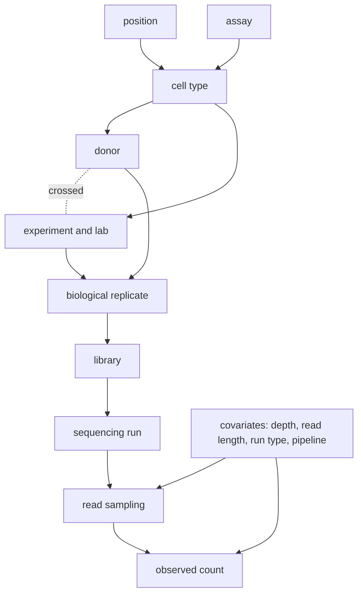

# onion total variance

This note writes the "peeling" of [[peeling the onion]] as one exact variance identity. It then says which term of the identity each onion layer and each headline metric of [[onion eval protocol#headline-metric-set]] estimates, on which scale, and under which assumptions. The assumptions are numbered (1) to (6) and are defined in [assumptions](#assumptions). The code read for this note is `tools/onion_eval/layers.py`, `error_budget.py`, `metrics.py`, `score.py`, `resolution.py`, `mixed_model.py` and `select_rule.py` at commit 7f457cb.

## identity

Y is the count of one assay in one bin of one track. The random element is a draw of a bin and a track. The conditioning sets form a chain, i.e. each set contains the one before it:

| set | contents |
|---|---|
| Z0 | assay, position |
| Z1 | Z0 + cell type |
| Z2 | Z1 + donor |
| Z3 | Z2 + experiment (lab, antibody lot, protocol) |
| Z4 | Z3 + biological replicate |
| Z5 | Z4 + library (technical replicate) |
| Z6 | Z5 + sequencing run |

The covariates C (depth, read length, run type, pipeline settings) are held fixed along the chain. The law of total variance, applied once per step of the chain, gives the identity:

```
Var(Y) = Var(E[Y|Z0])                                   position and assay
       + sum_{k=1..6} E[ Var( E[Y|Zk] | Z(k-1) ) ]      the six layers: cell type, donor, experiment,
                                                         biological replicate, library, sequencing run
       + E[ Var(Y|Z6) ]                                  read sampling
```

Call the k-th summand `T_k` (k = 1..6), the first summand `T_0`, and the last summand `T_s`. The identity is exact for any law of Y with a finite second moment.

**The sampling term is Poisson.** Given Z6 and C, the reads of a track are independent draws, so the count of a bin is Poisson given its rate. Then `Var(Y|Z6) = E[Y|Z6]` and `T_s = E[Y]` on counts. Any variance in excess of Poisson belongs to a layer `T_k` (most often the library layer, through PCR duplicates) or to the covariate layer. It never belongs to `T_s`.

**The covariate layer.** A change of C changes the rate. The variance that it causes, `Var_C( E[Y|Z6, C] )`, is a separate covariate layer outside the chain. Headline 4 measures the part of it beyond depth.

**Specific variance.** The specific variance of a cell is `T_1 + ... + T_6`, i.e. the variance of the truth around the across-cell mean `E[Y|Z0]` minus the sampling term.

**Pair value.** Let Y and Y' be two measurements of one bin that share Z(k-1), are exchangeable given Z(k-1) (conditionally independent and identically distributed), and have equal covariates. Then

```
0.5 E[(Y - Y')^2] = E[ Var(Y | Z(k-1)) ] = T_k + T_(k+1) + ... + T_6 + T_s.
```

Call `PV(Z(k-1))` the pair value of a set. A layer is the difference of two consecutive pair values: `PV(Z(k-1)) - PV(Zk) = T_k`.

**Dependence on depth (counts).** Under a multiplicative model of the rate, `T_s` grows in proportion to depth D and every `T_k` grows in proportion to D^2. A pair value is therefore defined only at one stated depth (assumption 2).

## graphical-model

An arrow means that the child's effect on the rate of the bin is drawn given its parents. The dotted link marks that donor and experiment are crossed in ENCODE: one experiment can hold several donors (anisogenic replicates), and one donor can appear in several experiments. The nested order of the chain (donor before experiment) is therefore a choice (assumption 3).



The chain sets map to the graph as follows. Z0 holds position and assay. Z1 adds cell type. Z2 and Z3 add donor and experiment and lab. Z4 to Z6 add biological replicate, library and sequencing run. Read sampling is the Poisson draw. Covariates act on the read sampling (depth) and on the observed count (read length, run type and pipeline settings change which reads are counted).

## rung-to-term-map

One row per rung of `layers.RUNGS` (in its order). "Shares" is the set of chain levels that both members of a pair hold in common. "Pair value" is `PV` of that set. "Layer increment" is what `layers.py` subtracts and the term that this isolates (PI ruling 30, 2026-11-12; `layers.lower_terms`). The rungs up to isogenic are nested. Donor and experiment are crossed in ENCODE, so the anisogenic and other_experiment rungs are siblings: each is taken over isogenic.

| rung (`layers.RUNGS`) | shares | pair value `0.5 E[(Y-Y')^2]` | layer increment (`increment_over`; `layer`) | assumptions |
|---|---|---|---|---|
| pseudoreplicate | Z6 | `T_s` | its own pair value; `sampling` | (1), (2), (6) |
| sequencing | Z5 | `T_6 + T_s` | over pseudoreplicate: `T_6`; `sequencing` | (1), (2), (5), (6) |
| technical | Z4 | `T_5 + T_6 + T_s` | over sequencing: `T_5`; `library` | (1), (2), (5), (6) |
| isogenic | Z3 | `T_4 + ... + T_s` | over technical: `T_4`; `biological_replicate` | (1), (2), (5), (6) |
| anisogenic | cell type and experiment (not the donor) | `T_2 + T_4 + T_5 + T_6 + T_s` | over isogenic: `T_2`; `donor` | (1), (2), (3), (5), (6) |
| other_experiment | cell type and donor (not the experiment) | `T_3 + T_4 + T_5 + T_6 + T_s` | over isogenic: `T_3`; `experiment` (lab, antibody lot, protocol) | (1), (2), (3), (5), (6) |
| other_cell_type | Z0 | `T_1 + ... + T_6 + T_s` | over `anisogenic+other_experiment-isogenic`, i.e. `PV(Z1)` of a pair that shares only the cell type, `T_2 + T_3 + T_4 + ... + T_s`: `T_1`; `cell_type` | (1), (2), (3), (5), (6) |

Here `T_2` and `T_3` are the donor and experiment terms as siblings: each is the variance that the level adds given the cell type and the other level. With crossed, additive levels the two sibling terms and the nested terms of the identity agree; with multiplicative levels (counts) each sibling term carries a factor of the other level (on counts, `PV(anisogenic) - PV(isogenic) = E[m^2](1 + c_ct)(1 + c_x) c_d` against the nested `E[m^2](1 + c_ct) c_d`). The cell-type row subtracts `PV(anisogenic) + PV(other_experiment) - PV(isogenic)`, which equals `PV(Z1)` exactly when donor and experiment add (no interaction). The total-variance audit tested it against a true pair that shares only the cell type (other donor and other experiment): cell-type layer 0.1993 [0.187, 0.2117] against a planted 0.1994 (log1p, seed 0).

When every rung has the same cells, the increments add up exactly: `PV(pseudoreplicate)` plus the increments of sequencing, technical, isogenic, anisogenic, other_experiment and other_cell_type equals `PV(other_cell_type)`.

How `layers.py` computes these rows (chunks TVf and TVg):
- `pair_variance` returns `Var(d)` with `d = log1p(a') - log1p(b')`, where a' and b' are binomially thinned to one common depth per assay (the shallowest side of any pair of that assay, a pseudoreplicate half included). `layer_table` stores the pair value `0.5 Var(d)` (assumption 6), as the mean over cells of each cell's mean pair value. The common depth is the `depth` column.
- A pseudoreplicate row of `pairs.tsv` (a = b) is read as its `pr1.h5` and `pr2.h5` halves at their own depths.
- An increment is taken per cell over the cells that populate every rung involved, then averaged over those cells. A rung whose cells differ from a rung that it subtracts is flagged `cells differ from lower rung` (assumption 5). An other_cell_type pair (two cells) is clustered on the cell of its `a` side.
- When a rung is empty, the increment of the next rung holds more than one term; its `layer` column names them (for example `cell_type+experiment` when other_experiment has no pair, which `build_tables.py` does not yet write).
- `resolution.py` reports the increments as `layer_table` gives them, i.e. in `PV` units.
- `mixed_model.py` is the order-free cross-check of the anisogenic and other_experiment rows. It fits cell, experiment, replicate and library as crossed random effects. When the table names a donor, the replicate level is the donor, labelled by cell and donor, so that it is crossed with experiment. Every observation of an assay is thinned to one common depth before log1p; no depth slope is fitted.

## metric-to-term-map

"Term" names the summands of [identity](#identity) and [model-variance](#model-variance). "Scale" is the space in which the metric is computed in `score.py` (counts_log1p = log1p of counts at the target's depth). `mu_hat` is the predicted NB mean and `n` its size.

| metric (key in `scores.json` or function) | term estimated | scale | assumptions |
|---|---|---|---|
| 1. `specific_variance_recovered_above_noise` (`metrics.specific_variance_recovered`) | `1 - (E_sp - N)/(V_sp - N)`: the share of the specific variance `T_1 + ... + T_6` that `mu_hat` explains. `V_sp` = the truth's variance minus its part shared with other cells (estimates `T_1 + ... + T_6 + T_s`). `N` = the Spearman-Brown noise floor from the target's two halves (estimates `T_s` only). The donor to sequencing layers therefore stay in the denominator. All terms are in units of each target's `Var(x)`. | counts_log1p (also signal_arcsinh for the EIC comparison) | (1), (2), (4), (5), (6) |
| 2. `r_spec` (`metrics.r_spec`) | `corr(y - g(a), p - h(a))`, with `a` the training average, an estimate of `E[Y|Z0]`. It is the correlation form of the same specific part, with no noise correction: its ceiling is below 1 by `T_s` and by every layer that the input does not determine. | counts_log1p | (2), (4), (5) |
| 3. `count_crps_skill_vs_position_average` (`metrics.crps_skill`) | `CRPS(position average) - CRPS(model)`. A proper score of the whole predictive law. The position average predicts `E[Y|Z0]`, so the skill reads the variance beyond Z0 that the model explains. It is no additive term of the identity. The `oracle_scaled` and `scale_error` split isolates the depth part of the covariate layer. | counts | (2), (5) |
| 4. correction gap closed (`metrics.gap_closed`) | `(CRPS_depth_only - CRPS_model)/(CRPS_depth_only - CRPS_floor)`: the share of the covariate layer beyond depth, `Var_C(E[Y|Z6,C])` minus its depth part, that the model removes. The floor is half against half, i.e. the sampling term only. Depth-only scaling is the baseline. | counts | (1), (2), (5) |
| 5. depth-law error (`metrics.depth_law_error`) | A first-moment check: `E[Y|Z6, depth]` is proportional to depth. It estimates no variance term. | counts (totals) | (5) |
| 6. PIT deviation, pooled and worst stratum (`metrics.pit_deviation`) | The whole law of `Y | S, C'`. Under a calibrated PIT within a stratum, the mean predicted variance `mu_hat + mu_hat^2/n` equals `E[(m - mu_hat)^2] + E[Var(Y|S,C')]` there ([model-variance](#model-variance)). | counts | (5) |
| 7. `predicted_over_replicate_variance` (`metrics.variance_ratio`) | Mean predicted NB variance over the pair value of one rung: the calibration ratio `rho` of [model-variance](#model-variance) for that rung. `score.py` calls it with the pseudoreplicate halves and the mean halved (`0.5 mu_hat`), so the headline is `rho(pseudoreplicate)` at half depth, with denominator `T_s`. | counts | (1), (2), (5), (6) |
| error budget `level` | `offset + scale + nonlinear` of `MSE/Var(x)`: first-moment error of the prediction (mean, scale, monotone shape). It is no layer term. | counts_log1p, units of `Var(x)` | (4) |
| error budget `shared` | Error energy common to the cells of an assay. It is the error in the `T_0` part. | counts_log1p, units of `Var(x)` | (4), (5) |
| error budget `specific` | Error energy specific to a track: the error in `T_1 + ... + T_6 + T_s`. | counts_log1p, units of `Var(x)` | (4), (5) |
| error budget `explained` | `C^2/P` per component (shared or specific part of one band): the truth variance that the calibrated prediction explains, capped at `V`. | counts_log1p, units of `Var(x)` | (4), (5) |
| error budget `noise` | `N`, the Spearman-Brown floor, in specific parts only: it estimates `T_s`. When `unexplained` would be negative, `N` is set to `V - explained` and `floor_flag` is set. | counts_log1p, units of `Var(x)` | (1), (2), (4), (6) |
| error budget `unexplained` | `V - explained - N`: in specific parts, the share of `T_1 + ... + T_6` that the prediction misses; in shared parts, the missed share of `T_0`. | counts_log1p, units of `Var(x)` | (1), (2), (4), (5) |
| error budget `added` | `E - (V - explained)`: error that the prediction adds through variance in the wrong place. It is no term of the truth's identity. | counts_log1p, units of `Var(x)` | (4) |
| error budget identities | `V = explained + unexplained + noise` and `E = unexplained + noise + added`, exact in each component and in the sums. | counts_log1p | none (algebraic) |
| D13 imputation term (`imputation_gap_closed`) | Headline 1, macro over scorable assays. | counts_log1p | as headline 1 |
| D13 correction term (`correction_gap_closed`) | Headline 4. | counts | as headline 4 |
| D13 uncertainty term (`uncertainty_gap_closed`) | `1 - PIT(arm)/PIT(marginal NB)`, i.e. headline 6 against the marginal NB. The marginal NB is one distribution per track, so its variance is the variance of Y over the positions of one track: the total of the identity with that track's own Z1 to Z6 held fixed. | counts | as headline 6 |
| D13 composite | `0.5 imputation + 0.25 correction + 0.25 uncertainty`, each term clipped to [0, 1] (`select_rule.CLIP_GOAL_TERMS`, PI ruling 18). A weighted sum of three shares, not a variance term. | mixed (as its terms) | as its terms |

## model-variance

Let S be the model's inputs and C' the target's covariates. Let `m = E[Y|S,C']` and let `mu_hat` be the predicted mean. The same law of total variance, with `m` split around `mu_hat`, gives

```
Var(Y) = Var(mu_hat) + E[(m - mu_hat)^2] + E[Var(Y|S,C')]
         - (E[m - mu_hat])^2 + 2 Cov(mu_hat, m - mu_hat).
```

The last two terms form the cross term. Both terms are zero when the mean is calibrated, i.e. `E[Y | mu_hat] = mu_hat`. So for a calibrated mean the total splits into the explained variance `Var(mu_hat)`, the missed signal `E[(m - mu_hat)^2]`, and the variance that S cannot determine, `E[Var(Y|S,C')]`.

**What the predicted NB variance estimates.** The predicted variance `mu_hat + mu_hat^2/n` estimates `E[Var(Y|S,C')]`. Its part `mu_hat` is the Poisson sampling term `T_s`. Its part `mu_hat^2/n` is the sum of the layers `T_k` that S does not determine.

**Two bounds.**
- Lower bound: `E[Var(Y|S,C')] >= T_s = PV(Z6)`, the pseudoreplicate pair value. No input removes the read sampling of the target.
- Upper bound: `E[Var(Y|S,C')] <= PV(Zk*) = E[Var(Y|Zk*)]`, where Zk* is the deepest set of chain levels that is a function of (S, C'). Conditioning on more information never raises the expected conditional variance.

**Calibration ratio per rung (headline 7; PI ruling 31).** For each rung r with pair value `PV_r`, define

```
rho(r) = mean(mu_hat + mu_hat^2/n) / PV_r     (both at one depth, over the same bins)
```

A model whose predicted variance lies within the bounds has `rho(pseudoreplicate) >= 1` and `rho(r*) <= 1` at the rung r* whose pair shares exactly Zk*. Neither bound alone says "calibrated": in the audit, a calibrated model that knows the cell type scored 2.57 against the halves. The upper-bound rung r* depends on what the model's inputs give it (`score.H7_UPPER_RUNG`):

| target | inputs S | Zk* | upper-bound rung r* |
|---|---|---|---|
| imputed (a missing assay of a cell, from other assays) | other tracks of the cell, covariates | Z1, the cell type | other_experiment of the same cell type. It shares only the cell type when the cell type has one donor (a cell line); with several donors it also shares the donor, and the right pair is one of another donor and another experiment (in the audit, ratio 1.013 [0.952, 1.075] at such a pair against 1.30 at other_experiment) |
| reconstructed (its own reads at other bins are an input) | the target's own reads | Z6: every level of the target is known from its own reads | pseudoreplicate: both bounds meet, and a calibrated model scores 1 |
| covariate-corrected (source pr1 -> target pr2 of one track) | the source half | Z6 (the two halves share every level) | pseudoreplicate of the target, at the target's covariates: both bounds meet |

What `score.py` reports (imputed targets; it does not score the other two kinds with headline 7). The old scalar `predicted_over_replicate_variance` keeps its value: the ratio against the target's own halves, now described as the lower-bound check. Beside it, `per_rung` holds the ratio at every rung that `pairs.tsv` populates for the target's cell and assay (the prediction thinned to each pair's depth), `pass_rate` the share of targets with `rho(pseudoreplicate) >= 1` and `rho(other_experiment) <= 1`, and `per_target` both. PIT deviation stays the selection metric for uncertainty; headline 7 is reported only.

## explained-per-layer

PI ruling 32 (2026-11-12): the explained fraction per layer is a reported metric. It never enters `select_rule.py`. Code: `layers.pair_explained`, `layers.explained_table`, `layers.predicted_layer_mean`; `score.py` key `explained_fraction_per_layer`.

**Estimator.** Take a layer k and the rung r whose increment isolates it ([rung-to-term-map](#rung-to-term-map); the donor and experiment layers are siblings over isogenic, the cell-type layer is over `anisogenic + other_experiment - isogenic`). For each pair (Y, Y') of a rung, the two counts are thinned to the common depth of the layer table and taken on its scale, log1p. The model predicts each member under that member's own inputs and covariates; its predicted mean on the layer scale is `e = E[log1p Y]` under its predictive law NB(n, mu) thinned to the common depth. With `d = log1p(Y) - log1p(Y')` and `d_hat = e - e'`, both centred over bins, define per pair

```
C = 0.5 mean(d_hat d)        (captured part)
PV = 0.5 mean(d^2)           (pair value, as in layers.tsv)
```

Average C and PV over the pairs of each cell. For the layer of rung r with the terms `sum_q k_q PV_q` that the layer table subtracts, over the cells that populate r and every q:

```
EF_k = mean_c [C_r(c) - sum_q k_q C_q(c)] / mean_c [PV_r(c) - sum_q k_q PV_q(c)]
```

The denominator is the layer term `T_k` of the layer table. The numerator is the captured part of `T_k`. The subtraction removes the sampling term and the lower layers from both, as the layer itself does.

**Why the covariance form.** Write `d = D_k + D_low + D_s`: the difference of the layer-k components, of the lower layers, and of the read sampling. When the model's inputs do not include the members' own reads, `d_hat` is a function of inputs that are independent of the members' own read sampling, so `E[d_hat D_s] = 0`. The captured part `0.5 E[d_hat D_k]` then equals `0.5 Cov(d_hat, d)` minus the same covariance with the lower layers, and the lower rung's C removes that part. So `EF_k = 0.5 E[d_hat D_k] / T_k`, the share of the layer term that the prediction difference captures (a regression coefficient of the layer component on the prediction difference, scaled by the layer term).

**Assumptions.** (1) The model's inputs do not contain the members' own reads. When they do (a reconstructed or self-corrected target), `d_hat` covaries with the sampling term `D_s`, C is biased upward, and the lower-rung subtraction removes the bias only if the leak is the same on both rungs. Then no explained fraction is reported. `score.py` computes it on imputed targets only. (2) Both members are at the common depth on the layer scale: `e` is taken under the prediction thinned to that depth. `log1p(mu_hat)` is not `E[log1p Y]` at a few reads per bin; with it, a model that knows the cell type exactly scored 1.07 in the simulation, against 0.99 with `e`. (3) The assumptions of the layer itself: exchangeable pairs, the same cells in every rung of the layer, and for the cell-type layer that donor and experiment add.

**Range and interval.** No clipping. With few pairs `EF_k` can be negative or above 1. It is reported with a 95% cluster-bootstrap interval over the cells that it uses (the `layers.py` form), the pair count and the cell count.

**What `score.py` fills today.** `score.py` predicts only imputation targets, i.e. the pooled base views. The layer is filled where the two members of an other_experiment or other_cell_type pair are both targets of the scored regime. The members of an isogenic or anisogenic pair (biological replicates of one experiment) are never predicted. For an imputed target they get the same inputs (the other assays of the cell) and the same covariates up to depth, so their `d_hat` is 0 at the common depth and their C is 0. `score.py` uses that, and it lists those rungs under `zero_by_shared_inputs`. Their pair values come from their reads. So the experiment layer and the cell-type layer can be filled; the nested layers and the donor layer cannot (their captured part is 0 by construction for an imputation model). `build_tables.py` writes no other_experiment pair yet, so on `eic_v1` the cell-type row is over anisogenic and its layer is `cell_type+experiment`.

**Check by simulation** (`tests/test_onion_eval_tv_fixes.py`; the audit chain, 6 cells, donor and experiment crossed). A model that knows the cell-type layer exactly and nothing else: cell type 0.987 [0.938, 1.037], experiment 0, donor 0 (seed 0; 0.991 and 1.005 on seeds 1 and 2). A model that also knows the experiment layer: cell type 0.997 [0.949, 1.045], experiment 0.944 [0.872, 1.015], donor 0 (seed 0). On seeds 1 and 2 the experiment layer gave 0.908 [0.886, 0.929] and 0.956 [0.882, 1.029]: it sits a few percent below 1. The model knows the experiment factor but averages over the donor that an other_experiment pair shares, and log1p does not separate the two exactly.

## scales

This section states the identity across bin sizes (plan Amendment 3, section C). It needs an additive measure: one count per read at one position (the point rule), so that the count at any bin size is the exact sum of the 1 bp counts. The overlap rule of the stored 25 bp counts (`tools/t112/bin25.py`) is not additive across bin sizes.

**Block identity.** Let Y be the 1 bp count at a position drawn at random from a region, and Z_b the index of the block of b bp that holds it. Then

```
Var(Y) = E[Var(Y | Z_b)] + Var(E[Y | Z_b]).
```

The first term is the variance below b. The block sum is `b E[Y|Z_b]`, so the variance of block sums is `b^2 Var(E[Y|Z_b])`.

**Nested chains.** The block partitions of a chain refine each other, so the identity telescopes exactly. For the chain 1, 5, 25, 125 bp:

```
Var(Y) = E[Var(Y|Z_5)] + E[Var(E[Y|Z_5] | Z_25)] + E[Var(E[Y|Z_25] | Z_125)] + Var(E[Y|Z_125]).
```

The chain 1, 5, 25, 50 bp has the same form. On a finite region the identity holds exactly for the empirical variance when the region length is a multiple of the largest block: the analysis uses the first 409,500 bp (3,276 blocks of 125 bp) for the chain that ends at 125 bp and the whole 409,600 bp (8,192 blocks of 50 bp) for the chain that ends at 50 bp. The Haar bands of `layers.py` and `error_budget.py` are the same identity with dyadic blocks of 25 x 2^j bp.

**Sampling term across scales.** At 1 bp under the point rule, the count is Poisson given its rate. The Poisson part of `Var(Y)` is `E[Y]`. Of that part, `(1 - 1/b) E[Y]` falls below b and `E[Y]/b` remains in the block means.

**Replicate-reproducible share.** For two pseudoreplicate halves h1 and h2 of one track, the read sampling is independent between halves given the rate. So `Cov(h1, h2)` over positions contains no sampling term. The same holds for the block means of the halves at each block size. The reproducible share at each step of a chain is the step term computed from the cross-covariance of the halves in place of the variance.

**log1p.** On log1p of the block sums the identity holds for each fixed b, but the terms are not additive across b: log1p of a sum is not the sum of log1p values. Results on that scale are reported as not additive.

## assumptions

Each assumption is a condition under which an estimator of [rung-to-term-map](#rung-to-term-map) or [metric-to-term-map](#metric-to-term-map) estimates its term without bias.

1. **Exchangeable pair.** The two members of a pair are conditionally independent and identically distributed given the set that they share. A pair that shares reads (for example, a depth subset of a parent) violates it. Pseudoreplicate halves meet it only when the read split is random and the reads are independent given Z6.
2. **Equal covariates, above all equal depth.** Both members of a pair, both rungs of a difference, and the model and the truth are at one depth on the scale used. On counts, `T_s` scales with depth and each `T_k` scales with depth squared. The tools thin the deeper track binomially to the shallower depth. Pseudoreplicate halves are at half the depth of the pooled track.
3. **Order of conditioning.** The chain nests donor before experiment, but in ENCODE donor and experiment are crossed. `layers.py` therefore takes the donor and experiment layers as siblings, each over isogenic (PI ruling 30), and the cell-type layer over `PV(anisogenic) + PV(other_experiment) - PV(isogenic)`, which is the pair value of a pair that shares only the cell type when donor and experiment add (no interaction). `mixed_model.py` is the order-free check.
4. **Scale.** The identity is exact for counts. On log1p it holds only at one fixed depth, and its sampling term then depends on the rate of the bin (it is not `E[Y]`). The error budget, headlines 1 and 2, and `layers.py` work on log1p.
5. **Same cells and positions.** Both rungs of a difference, and the model and the baseline of a skill, use the same cells, regions and strata. A difference over two different cell sets mixes a layer with the variance between cell sets.
6. **Factor 0.5 and the mean term.** `0.5 E[(Y - Y')^2]` equals `E[Var(Y|Z)]` only when `E[Y - Y' | Z] = 0`. The variance of the difference, `Var(Y - Y')`, removes the mean of the difference; the mean square difference keeps it. The two agree only for an exchangeable pair at equal depth. `layers.pair_variance` returns `Var(d)`; `layers.tsv`, `resolution.py` and `metrics.variance_ratio` hold the pair value, half of it.
